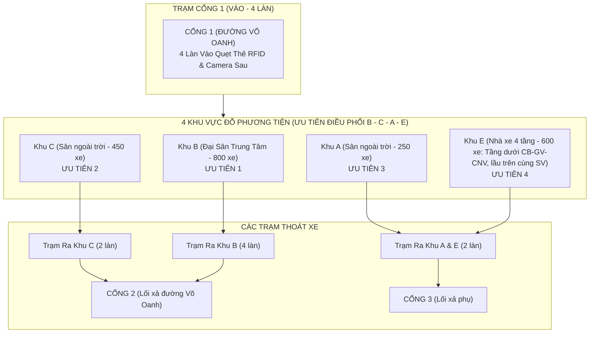

# ĐẶC TẢ YÊU CẦU PHẦN MỀM SƠ BỘ (PRELIMINARY SRS)
## HỆ THỐNG QUẢN LÝ BÃI ĐỖ XE THÔNG MINH ĐA KHU VỰC UTH CƠ SỞ 1
**Học phần**: Đồ án thực tế Công nghệ phần mềm (Mã HP: 122039 - Mã lớp: 012012213907)  
**Trường**: Đại học Giao thông Vận tải TP.HCM (UTH)  
**Giảng viên hướng dẫn**: Thầy Vũ Đình Long  
**Nhóm sinh viên thực hiện**: 
1. Đặng Đình Khang (Nhóm trưởng - MSSV: 027206013096)
2. Nguyễn Quang Huy (MSSV: 034206012355)
3. Nguyễn Xuân Hoàng (MSSV: 66206000135)
4. Thạch Thị Trâm (MSSV: 51306002444)

---

## 1. GIỚI THIỆU (INTRODUCTION)

### 1.1. Mục đích tài liệu
Tài liệu Đặc tả Yêu cầu Phần mềm (Software Requirements Specification - SRS) sơ bộ này mô tả các yêu cầu chức năng (FR), yêu cầu phi chức năng (NFR), mô hình kiến trúc và các ràng buộc nghiệp vụ cho hệ thống "Quản lý Bãi đỗ xe Thông minh Đa khu vực tại Trường Đại học Giao thông Vận tải TP.HCM Cơ sở 1". Tài liệu phục vụ cho đợt báo cáo HĐ 2 (Chương 2) theo đề cương chi tiết học phần môn Capstone Project on Software Engineering.

### 1.2. Phạm vi sản phẩm (Product Scope)
Hệ thống là giải pháp phần mềm quản trị bãi xe máy tập trung và đa điểm kiểm soát:
- **Địa bàn**: Khuôn viên Cơ sở 1 UTH (Số 2 Võ Oanh, Phường 25 / Thạnh Mỹ Tây, Bình Thạnh).
- **Phân khu quản lý & Định mức sức chứa (Tổng 2.100 xe)**: 4 khu vực đỗ xe với thuật toán điều phối ưu tiên thông minh theo thứ tự **B -> C -> A -> E** gồm: Đại Sân Khu B (800 xe - ưu tiên 1), Sân Khu C (450 xe - ưu tiên 2), Sân Khu A (250 xe - ưu tiên 3) và Nhà xe Khu E kết cấu thép 4 tầng (600 xe - ưu tiên 4 cho sinh viên leo lầu 3; các tầng dưới dành riêng cho CB-GV-CNV).
- **Mạng lưới trạm kiểm soát**:
  - *Cổng 1 (Võ Oanh)*: Trạm vào 4 làn song song.
  - *Cổng 2*: Trạm xả Khu C (1 trạm bốt di động gồm 2 làn song song) và Trạm xả Khu B (4 làn).
  - *Cổng 3*: Trạm xả Khu A & E (2 làn).
- **Công nghệ & Thiết bị trạm bốt (Control Booth)**:
  - Nhận diện biển số tự động (ALPR) qua **1 Camera sau** (chụp đuôi xe máy).
  - Định danh phương tiện bằng **Thẻ trắng chip RFID in logo UTH** (bảo mật tuyệt đối, mắt thường không đọc được số thẻ/biển số).
  - **Mô hình Trạm bốt kiểm soát 2 làn**: Kiosk di động khung kim loại đặt tim giữa 2 làn xe dưới mái che bạt tiền chế, trang bị màn hình POS chia luồng camera 2 làn, đầu đọc thẻ RFID USB để bàn, rổ đựng thẻ UTH, khay thu tiền mặt và dải gờ giảm tốc cao su vàng-đen điều tiết dừng xe.
  - **Chính sách phí & Phân luồng đỗ xe**:
    - **Cán bộ - Giảng viên - CNV (CB-GV-CNV)**: **Hoàn toàn miễn phí** (0 VNĐ), barrier tự động mở ngay khi quẹt thẻ nhân sự hợp lệ; ưu tiên đỗ tại các tầng dưới của Nhà xe Khu E (không phải leo dốc cao).
    - **Sinh viên / Khách vãng lai**: Thu phí đồng giá **5.000 VNĐ / lượt** trong ngày; phụ phí qua đêm **5.000 VNĐ** (tổng 10.000 VNĐ nếu qua 23h00); điều phối xe ưu tiên theo thứ tự **B -> C -> A -> E** (chỉ gửi lên lầu trên cùng Khu E khi các sân ngoài trời đã đầy).
  - Tích hợp thanh toán số **VietQR động** chuẩn Napas 247.

---

## 2. MÔ TẢ TỔNG QUAN (OVERALL DESCRIPTION)

### 2.1. Bối cảnh không gian thực tế UTH Cơ sở 1

### 2.2. Các tác nhân hệ thống (Actors)
1. **Bảo vệ trực cổng (Operator)**: Quẹt thẻ cho xe vào tại Cổng 1; quẹt thẻ xác thực thẻ Cán bộ - Giảng viên (miễn phí 0đ, tự mở barrier) hoặc thu tiền 5k/10k cho sinh viên và kiểm tra khớp biển tại Cổng 2, Cổng 3; mở ca và chốt ca trực.
2. **Trưởng ca / Quản trị viên (Supervisor / Admin)**: Xử lý sự cố mất thẻ xe, giải quyết các trường hợp lệch biển số (`MISMATCH`), xem nhật ký kiểm toán và báo cáo doanh thu toàn trường.
3. **Sinh viên / Khách gửi xe (Customer)**: Nhận thẻ khi vào, trả thẻ khi ra, thanh toán tiền mặt hoặc quét mã VietQR 5k/10k.

---

## 3. YÊU CẦU CHỨC NĂNG (FUNCTIONAL REQUIREMENTS - FR)

### Nhóm 1: Quản lý Xe vào (Check-in at Gate 1)
- **FR 1.1**: Hệ thống đọc mã UID từ thẻ trắng RFID qua đầu đọc thẻ USB tại 1 trong 4 làn Cổng 1.
- **FR 1.2**: Camera sau tự động chụp ảnh biển số xe máy, module AI ALPR nhận diện và trích xuất chuỗi ký tự biển số.
- **FR 1.3**: Hệ thống phân loại đối tượng gửi xe và tự động gợi ý/gán khu vực đỗ theo thứ tự ưu tiên tối ưu **B -> C -> A -> E** cho sinh viên (ưu tiên các sân ngoài trời thuận tiện di chuyển; chỉ đưa lên Lầu 3 Nhà xe Khu E khi các sân đã đầy); Cán bộ - Giảng viên được phân bổ đỗ tại các tầng dưới của Khu E (miễn phí 0đ, không leo dốc).
- **FR 1.4**: Tạo bản ghi vé xe trạng thái `IN_PARKING` lưu trữ: Mã thẻ UID, đối tượng (`user_type`), biển số nhận diện, ảnh chụp sau, thời gian vào, mã cổng/làn, và ID bảo vệ trực.

### Nhóm 2: Quản lý Xe ra & Đối chiếu (Check-out at Gate 2 & Gate 3)
- **FR 2.1**: Tiếp nhận thẻ từ người gửi xe tại Trạm C (1 trạm gồm 2 làn), Trạm B (4 làn) (Cổng 2) hoặc Trạm A-E (Cổng 3).
- **FR 2.2**: Camera sau tại làn ra chụp ảnh biển số xe máy đang chờ xuất bến.
- **FR 2.3**: Hệ thống tự động so khớp biển số xe ra với biển số xe vào được gắn với mã thẻ UID:
  - *Nếu Khớp (MATCH)*:
    - Nếu là Cán bộ - Giảng viên - CNV (`STAFF`): Phí 0 VNĐ, tự động nâng cần barrier mở lối đi ngay.
    - Nếu là Sinh viên / Khách: Bật chỉ thị Xanh, hiển thị số tiền 5.000đ (hoặc 10.000đ qua đêm) và mã VietQR.
  - *Nếu Không Khớp (MISMATCH)*: Bật cảnh báo Đỏ, khóa cổng và yêu cầu bảo vệ xác minh thủ công.
- **FR 2.4**: Tăng lại 1 chỗ trống cho khu vực đỗ tương ứng sau khi xe xuất bãi thành công.

### Nhóm 3: Thu phí & Thanh toán số (Tariff & Payment Engine)
- **FR 3.1**: Cán bộ - Giảng viên - CNV (CB-GV-CNV) được miễn phí 100% (0 VNĐ). Mặc định áp dụng mức phí đồng giá **5.000 VNĐ / lượt** cho sinh viên / khách trong ngày.
- **FR 3.2**: Tự động phát hiện xe sinh viên gửi qua đêm (qua mốc 23h00 đêm hoặc sang ngày tiếp theo) để cộng thêm phụ phí qua đêm **5.000 VNĐ** (Tổng thu: **10.000 VNĐ**).
- **FR 3.3**: Cung cấp tùy chọn thanh toán tiền mặt (bấm xác nhận 1 chạm) hoặc sinh mã **VietQR động** chứa chính xác số tiền và mã vé để người gửi quét thanh toán tức thì.

### Nhóm 4: Quản lý Sức chứa 4 Khu (Zone Capacity Monitoring)
- **FR 4.1**: Thiết lập định mức sức chứa tối đa bám sát phân tích thực địa theo thứ tự ưu tiên **B -> C -> A -> E**: Đại Sân Khu B (800 xe - ưu tiên 1), Sân Khu C (450 xe - ưu tiên 2), Sân Khu A (250 xe - ưu tiên 3) và Nhà xe Khu E 4 tầng (600 xe - ưu tiên 4), tổng sức chứa toàn trường đạt 2.100 xe máy.
- **FR 4.2**: Tính toán số lượng xe đang đỗ và tỷ lệ phần trăm lấp đầy thời gian thực của từng khu.
- **FR 4.3**: Hiển thị cảnh báo trực quan khi một khu vực đạt ngưỡng $\ge 90\%$ (sắp đầy) hoặc $100\%$ (hết chỗ).

### Nhóm 5: Quản lý Ca trực & Đối soát Tài chính (Shift Management)
- **FR 5.1**: Cho phép nhân viên bảo vệ mở ca trực tại cổng/trạm cụ thể và khai báo số tiền mặt đầu ca.
- **FR 5.2**: Tự động tổng hợp doanh thu trong ca theo công thức:
  $$\text{Tổng doanh thu} = (\text{Số lượt xe ra trong ngày} \times 5.000đ) + (\text{Số lượt xe qua đêm} \times 10.000đ)$$
- **FR 5.3**: Bóc tách chính xác số tiền mặt phải nộp lại cho thủ quỹ và số tiền chuyển khoản VietQR đã vào tài khoản ngân hàng nhà trường.

### Nhóm 6: Xử lý Ngoại lệ & Nhật ký Kiểm toán (Incident & Audit Log)
- **FR 6.1 (Quy trình mất thẻ)**: Cho phép Trưởng ca nhập biển số xe để truy vết ảnh camera sau lúc vào, lập biên bản bàn giao xe và khóa vĩnh viễn thẻ bị mất sang trạng thái `LOST`.
- **FR 6.2 (Audit Log)**: Ghi nhận 100% các thao tác sửa biển số, duyệt xe lệch biển, mở rào khẩn cấp vào nhật ký kiểm toán không thể xóa sửa.

---

## 4. YÊU CẦU PHI CHỨC NĂNG (NON-FUNCTIONAL REQUIREMENTS - NFR)

- **NFR 1 (Tốc độ & Hiệu năng)**: Thời gian từ lúc quẹt thẻ + camera chụp sau nhận diện đến khi hiển thị kết quả trên màn hình $\le 1.5$ giây / lượt xe.
- **NFR 2 (Độ chính xác ALPR)**: Tỷ lệ nhận diện chính xác biển số xe máy Việt Nam đạt $\ge 95\%$ trong điều kiện ánh sáng bình thường và $\ge 90\%$ trong điều kiện thiếu sáng nhà lầu E.
- **NFR 3 (Bảo mật & Phân quyền)**:
  - Mật khẩu người dùng mã hóa bằng thuật toán PBKDF2 với Salt ngẫu nhiên.
  - Xác thực API thông qua signed Bearer JSON Web Token (JWT).
  - Tự động khóa tài khoản tạm thời sau 5 lần đăng nhập thất bại liên tiếp.
- **NFR 4 (Tính sẵn sàng & Dễ bảo trì)**:
  - Kiến trúc phân tầng rõ ràng (API Layer -> Service Layer -> Repository Layer -> Database).
  - Hệ thống hỗ trợ chế độ nhập tay cứu nguy (Manual Rescue Override) khi camera gặp sự cố mất kết nối.
- **NFR 5 (Độ bao phủ kiểm thử)**: Bộ kiểm thử tự động `pytest` đạt độ bao phủ mã nguồn $\ge 80\%$.

---

## 5. RÀNG BUỘC PHÁP LÝ & QUY CHUẨN KỸ THUẬT (REGULATORY CONSTRAINTS)

1. **Khung giá dịch vụ**: Tuân thủ Quyết định số 35/2018/QĐ-UBND của UBND TP.HCM về giá tối đa dịch vụ trông giữ xe tại các trường học trên địa bàn Thành phố.
2. **Cơ sở pháp lý gửi giữ tài sản**: Đáp ứng Điều 554 – 557 Bộ luật Dân sự 2015 thông qua việc số hóa vé xe, lưu vết ảnh chụp đuôi xe lúc vào/ra và thời gian gửi giữ làm bằng chứng số học (Digital Evidence).
3. **An toàn Phòng cháy Chữa cháy (PCCC)**: Đáp ứng QCVN 06:2022/BXD thông qua module giám sát sức chứa (Capacity Tracking) không để bãi xe vượt quá số lượng gây cản trở lối thoát nạn.
4. **Chuyển đổi số & Thanh toán không tiền mặt**: Hưởng ứng Quyết định 1813/QĐ-TTg của Thủ tướng Chính phủ thông qua tích hợp thanh toán mã VietQR 5k/10k động chuẩn Napas 247.

---
*Bản đặc tả yêu cầu sơ bộ được lập ngày 19/10/2026 bởi Nhóm Đặng Đình Khang.*  
**Đại diện nhóm ký tên**: *Đặng Đình Khang*
